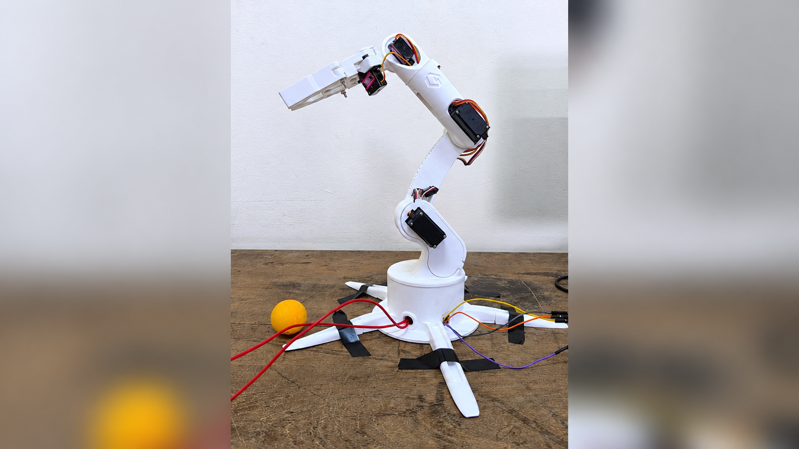
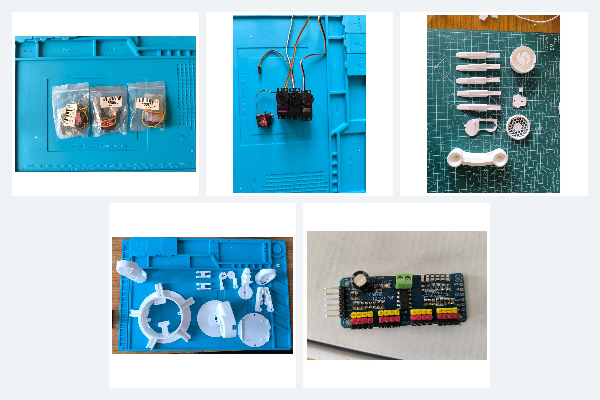

# 6-Axis Robotic Arm

A custom-built 6-axis robotic arm powered by an Arduino Uno and a PCA9685 16-channel PWM servo driver. Programmed to execute precise automated routines including a mid-air vertical drop and a multi-step pick-and-place operation.

## Features

- Executes automated, multi-step kinematic routines via Teach-and-Playback arrays[cite: 11].
- **Vertical Drop:** A 6-step sequence gripping a ball, elevating it to a fixed position, and releasing it mid-air[cite: 10].
- **Pick and Place:** A 9-step sequence gripping a ball, transporting it to a secondary location by rotating the base, releasing it on the ground, and smoothly returning to the home position[cite: 9].
- Custom step-function mapping to ensure slow, smooth motor movements without mechanical jerking[cite: 9].
- Split-map calibration for hardware-accurate 0° to 180° servo positioning, locking the 90° center exactly at 1500 µs to prevent center drift[cite: 12].
- Hardcoded safety constraints locking the gripper motor to a 90° maximum limit to prevent mechanical gear stripping[cite: 9, 10].

## Components Required

- Arduino Uno
- PCA9685 16-channel 12-bit PWM servo driver board (Operating at 50 Hz)[cite: 12]
- 3x MG996R Servo Motors (Elbow, Shoulder, Base)[cite: 9]
- 3x MG90S Servo Motors (Gripper, Wrist, Upper Elbow)[cite: 9]
- 3D Printed Structural Chassis
- External 5V/6V Power Supply (High current required for 6 servos)
- Breadboard and jumper wires

## Hardware Mapping & Calibrated Pulses

The wiring is structured in reverse order (Motor 1 is the Gripper, Motor 6 is the Base)[cite: 9, 10]. 

| Joint | Motor Type | PCA9685 Channel | 0° Pulse (Min) | 90° Pulse (Center) | 180° Pulse (Max) |
|---|---|---|---|---|---|
| Gripper | MG90S | 0 | 600 µs | 1500 µs | 2400 µs (Math placeholder) |
| Wrist | MG90S | 1 | 600 µs | 1500 µs | 2400 µs |
| Upper Elbow | MG90S | 2 | 600 µs | 1500 µs | 2400 µs |
| Elbow | MG996R | 3 | 700 µs | 1500 µs | 2350 µs |
| Shoulder | MG996R | 4 | 700 µs | 1500 µs | 2350 µs |
| Base | MG996R | 5 | 700 µs | 1500 µs | 2350 µs |

## Software Requirements

- Arduino IDE
- Adafruit_PWMServoDriver library
- Wire library (built-in for I2C communication)

## Repository Structure

To run the code in the Arduino IDE without compiler errors, the `.ino` files are stored inside identically named folders:
- `Vertical_Drop_Routine/Vertical_Drop_Routine.ino`
- `Pick_and_Place_Routine/Pick_and_Place_Routine.ino`
- `images/`

## How It Works

The Arduino sends I2C commands to the PCA9685 driver board, generating precise PWM pulses for all six servos simultaneously[cite: 9, 10]. The codebase utilizes split hardware-calibrated microsecond pulse limits for both the MG996R and MG90S motors, guaranteeing exact mechanical alignment across their respective sweeps[cite: 12]. Pre-recorded array coordinates define the operational poses (Home, Hover, Grab, Drop)[cite: 9], and a custom loop function interpolates the movement slowly to maintain stability[cite: 10]. 

## Project Photos

## Video Demonstration

## Limitations

- The arm requires a high-current external power supply; running from USB alone will cause voltage drops and brownouts.
- Relies on hardcoded coordinate arrays (Teach-and-Playback) rather than live Inverse Kinematics or computer vision[cite: 11].
- The Gripper (Motor 1 on Channel 0) is hard-coded with a 90° maximum limit to prevent mechanical binding[cite: 9, 10].

## Author

Ankur Deep Konch